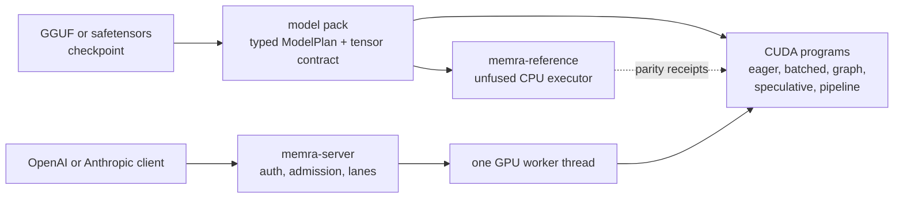

# memra

[](https://github.com/avifenesh/memra/actions/workflows/ci.yml)
[](https://github.com/avifenesh/memra/releases/latest)
[](LICENSE)

**Memra is an LLM inference engine in Rust and CUDA for NVIDIA Blackwell: RTX PRO 6000, RTX
50-series and DGX Spark.** One binary, `memra-server`, serves the OpenAI and Anthropic APIs from
hand-written NVFP4 and mixed-precision kernels, with no Python between the request and the GPU.
Built by [Avi Fenesh](https://github.com/avifenesh) at [tiyuvta](https://tiyuvta.ai).

[Project status](#project-status) · [Quick start](#quick-start) · [What runs where](#what-runs-where) ·
[How it works](#how-it-works) · [Evidence and limits](#evidence-and-limits) ·
[Documentation](#documentation) · [Contributing](#contributing) · [License](#license)

- **Defaults per device.** Where an interleaved A/B on a card finds a different winner, a plain
  `memra-server` on that card runs it. For example, a cold prompt of 1,024 tokens or more drafts at
  K=2 on the RTX 5090 Laptop GPU and the RTX PRO 6000 Max-Q, and at K=3 elsewhere
  ([decision](docs/decisions/SPEC-K-COLD-LONG-K2.md)).
- **Exactness gates per model and card.** Before every tag, and for every push that reaches
  `sm_120a` or `sm_121a`, speculative decoding on the gated checkpoints must return the plain
  decoder's greedy tokens at every draft length K=1..8. The rule for every fast path: a request
  never switches numeric programs mid-stream unless a serving-shape gate proves the switch
  bit-identical ([rule](ARCHITECTURE.md#one-numeric-program-per-request)).
- **Masked draft heads.** An opt-in trim (`MEMRA_FRSPEC_TRIM`) cuts Qwen3.8-27B's MTP draft head
  from 248,320 to 32,768 rows, ranked from the model's own generations. Verification keeps the full
  vocabulary, so the trim moves draft cost and acceptance, never the output
  ([model card](docs/models/qwen38-27b.md)).

> Qwen3.8-27B (NVFP4+Q5_K GGUF, untrimmed MTP draft head) decodes at 105 tok/s on one RTX PRO 6000 Blackwell
> Max-Q at 250 W and at 63 tok/s on an RTX 5090 Laptop GPU: one cold prompt of about 1,240 tokens at
> a time, 400-token answers at T=1, 8,192-token context, medians of 24 requests over six boots per
> card, 2026-11-09 ([table and conditions](#what-the-quick-start-settings-measured)).

## Project status

Memra is in active development: model-specific correctness, per-device defaults, native model
support and serving speed. Each claim lands with its gates and raw receipts. A tag ships only after
the release battery passes; the installer takes the latest release, and `main` can run ahead of it.

## Quick start

Four steps from a Linux x86_64 host to a streamed reply, with no CUDA toolkit, `nvcc` or Python.
The prebuilt needs a compute capability 12.0 GPU, glibc 2.35 or newer, driver 580 or newer and the
CUDA 13 runtime (`libcudart.so.13`, `libcublas.so.13`, `libcublasLt.so.13`).

**1. Check the card.** `nvidia-smi --query-gpu=name,compute_cap,memory.total --format=csv,noheader`
prints a line such as `NVIDIA GeForce RTX 5090 Laptop GPU, 12.0, 24463 MiB`. Any other compute
capability builds from source or has no build target ([what runs where](#what-runs-where)).

**2. Install and check the kernels.**

```bash
curl -fsSL https://raw.githubusercontent.com/avifenesh/memra/main/tools/install.sh | sh
export PATH="$HOME/.local/bin:$PATH"
kernel-check
```

The installer prints `Verified OK` (the cosign signature on the release's `SHA256SUMS`), checks the
archive digest and prints `installed: memra-server run-gen run-spec kernel-check`: the bytes the
tag battery ran, since the release rebuild must reproduce the record's SHA-256 or nothing ships.
`kernel-check` checks each kernel cell against a CPU reference or, for a rewrite, bit-identity with
the GPU program it replaces, prints `SKIP` where a cell's model file or input is absent and ends with `ALL GREEN (<n> cells, <m> skipped)`. A `libcudart.so.13`
load error means the CUDA 13 runtime is missing ([troubleshooting](docs/INSTALLATION.md#troubleshooting)).

**3. Serve a model.** With 24 GB or more, serve Qwen3.8-27B (a 15.7 GB file, MTP head inside):

```bash
REPO=tiyuvta/Qwen3.8-27B-NVFP4-MTP-GGUF FILE=Qwen3.8-27B-NVFP4-Q5K-mtp.gguf
curl -fL --create-dirs -o ~/models/$FILE https://huggingface.co/$REPO/resolve/main/$FILE
MEMRA_MODELS="qwen=$HOME/models/$FILE" MEMRA_CTX=8192 MEMRA_MAX_SESSIONS=2 memra-server
```

Under 24 GB, set `REPO=michaelw9999/Qwen3.5-9B-NVFP4-MTP-GGUF FILE=Qwen3.5-9B-NVFP4-MTP-GGUF.gguf`
(5.7 GB; its [serving cells](docs/models/qwen35-9b.md) passed on 24 GB, and no smaller card has a
receipt). The two limits set the measured shape below. Look for these boot lines (the 9B: 33 layers):

```text
[worker]   loaded "qwen": 65 layers, eos=248046, stop=[248046]
[spec-k] automatic table: prompt<1024 -> K=3; cold-long -> K=2; ...
[prime-walk] model="qwen" route=mtp supported=true yield_door=true [... mtp_head_loaded=true ...]
[server] listening on http://127.0.0.1:8080
```

`route=mtp`: the checkpoint's own MTP head drafts; other cards print `cold-long -> K=3`. Off
loopback (`MEMRA_ADDR`), the server refuses to start without `MEMRA_API_KEY` or `MEMRA_API_KEYS`.
`qwen=hf:tiyuvta/Qwen3.8-27B-NVFP4-MTP-GGUF:Q5K-mtp` fetches the file on first start with the `hf` CLI
([models](docs/INSTALLATION.md#models)), whose installer needs Python 3.10 or newer with `venv`:
`curl -LsSf https://hf.co/cli/install.sh | bash -s -- --exclude-skill`.

**4. Send a request.**

```bash
curl -sN http://127.0.0.1:8080/v1/chat/completions -H 'Content-Type: application/json' -d '{
  "model": "qwen", "stream": true, "max_tokens": 128, "reasoning_effort": "none",
  "messages": [{"role": "user", "content": "Explain KV caching in one sentence."}]}'
```

```text
data: {"object":"chat.completion.chunk","model":"qwen","choices":[{"index":0,"delta":{"content":"KV","role":"assistant"},"finish_reason":null}],...}
...
data: {"object":"chat.completion.chunk","model":"qwen","choices":[{"index":0,"delta":{},"finish_reason":"stop"}],"usage":{...,"spec":{"rounds":14,"drafted":42,"accepted":21,...}},...}
data: [DONE]
```

Without `"reasoning_effort": "none"`, thinking streams first as `delta.reasoning` and spends the
same budget. OpenAI SDKs take `base_url="http://127.0.0.1:8080/v1"` and any key string, Anthropic
SDKs `http://127.0.0.1:8080`. `/v1/completions` answers in memra's native shape (`text`, `tokens`,
`stop_reason`) unless `MEMRA_COMPAT=openai`, or `MEMRA_COMPAT` unset and `MEMRA_API_KEY` set.

### What the quick start settings measured

Qwen3.8-27B with the step 3 limits: cold, distinct prompts, 400-token answers at T=1, thinking off,
K=2 (the default on both cards since), untrimmed draft head, decode timed from the first content
chunk. Boots interleaved with a K=3 arm on main `1273a16f07`, 2026-11-09
([receipt](research/spec-k-cold-long-20261109/README.md),
[two at once](research/spec-k-cold-long-c2-20261109/README.md)); the Max-Q two-at-once row is from
2026-11-10 on the K=2 flip's tree before it landed (`5898f5190d`, landed as `40791700b6`;
[receipt](research/spec-k-cold-long-c2-pro6000-20261110/README.md)). The laptop throttles under this
load (SM clock 1,342 to 1,672 MHz between boots). These runs predate position-keyed sampled verify
(v0.141.0), which moved T=1 decode by 0.999 to 1.039 times on the RTX 5090; the Max-Q has no cell
since ([record](docs/decisions/SAMPLED-VERIFY-POSITION-KEYED.md)).

| Card | At once | Prompt tokens | Requests (boots) | Peak °C per boot | TTFT p50 | Decode per request, median (range) |
|---|---:|---:|---:|---:|---:|---:|
| RTX PRO 6000 Blackwell Max-Q, 250 W limit | 1 | 1,239-1,286 | 24 (6) | 89-91 | 0.56 s | 105 tok/s (103-110) |
| RTX PRO 6000 Blackwell Max-Q, 250 W limit | 1 | 3,565-3,697 | 24 (6) | 89-90 | 1.37 s | 102 tok/s (96-106) |
| RTX PRO 6000 Blackwell Max-Q, 250 W limit | 2 | 1,239-1,286 | 12 (6) | 82-85 | 0.77 s | 72 tok/s (68-78); 126 tok/s per pair, prefill included |
| RTX 5090 Laptop GPU, 24 GB | 1 | 1,239-1,286 | 24 (6) | 90-91 | 1.18 s | 63 tok/s (53-71) |
| RTX 5090 Laptop GPU, 24 GB | 1 | 3,565-3,697 | 24 (6) | 89-92 | 3.31 s | 61 tok/s (54-68) |
| RTX 5090 Laptop GPU, 24 GB | 2 | 1,239-1,286 | 12 (6) | 89-91 | 1.75 s | 40 tok/s (35-45); 68 tok/s per pair, prefill included |

One result went against the engine's own choice: on the Max-Q its cost model picked K=3, and K=2
measured faster at every length from 1,240 to 5,900 tokens (105.1 against 100.6 tok/s at 1,240, all
36 boot pairs), so the rung moved; on the RTX 5090 Laptop, one 1,240-token request at a time, the
two tied. Not measured here: three or more requests at once (with `MEMRA_MAX_SESSIONS=2` a third
request queues; above two live sessions plain decoding takes over unless a calibrated cost model
keeps drafting), the desktop RTX 5090, other RTX 50-series cards, the other PRO 6000 editions,
Qwen3.5-9B, contexts above 8,192. Every other number, with its card, N and date, is in
[Performance](docs/PERFORMANCE.md) and the model cards; ratios against other engines stay in
Performance, next to their protocol.

## What runs where

A binary loads only on the compute capability it was built for. `sm_120a` and `sm_121a` are
push-gated: a push that reaches one needs a passing record from a device of that target.

| GPU | Install | Measured there | Next |
|---|---|---|---|
| [RTX PRO 6000 Blackwell](docs/rigs/rtx-pro-6000-blackwell.md), 96 GB | prebuilt, `sm_120a` | Qwen3.8-27B and Ornith-1.5-35B-A3B before every tag; Step-3.7-Flash and DeepSeek-V4-Flash across cards; GLM-5.3-Flash on one card and pairs | Qwen3.8-27B at [full context](docs/COOKBOOK.md#rtx-pro-6000-blackwell-dflash2-drafter-at-full-context); Step-3.7-Flash [over PP-2](docs/COOKBOOK.md#2x-rtx-pro-6000-blackwell-pp-2) |
| [RTX 5090 Laptop GPU](docs/rigs/rtx-5090.md), 24 GB | prebuilt, `sm_120a` | Qwen3.8-27B, Qwen3.5-9B, Gemma 4, Qwen3.6 | the [24 GB DFlash2 block](docs/COOKBOOK.md#rtx-5090-laptop-gpu-24-gb-dflash2-drafter) |
| RTX 5090 (32 GB), other RTX 50-series | prebuilt, `sm_120a` | one device-penalty cell on the desktop RTX 5090; it takes the RTX 5090 defaults, not the laptop's | the quick start; a [hardware validation report](https://github.com/avifenesh/memra/issues/new?template=hardware-validation.md) helps |
| [DGX Spark (GB10)](docs/rigs/dgx-spark.md) | source on the Spark, `sm_121a` | Qwen3.8-27B at 262,144 tokens, Qwen3.6-35B-A3B | [build on the Spark](docs/INSTALLATION.md#build-from-source) |
| [B200](docs/rigs/b200.md) | source, `sm_100a`, best effort | Qwen3.5-9B, Qwen3.8-27B FP8, GLM-5.3-Flash, September 2026 | [build from source](docs/INSTALLATION.md#build-from-source) |
| [H100](docs/rigs/h100.md); [Ada](docs/rigs/ada.md): RTX 40-series, L4, L40S | source, `sm_90a` or `sm_89`, not maintained | H100: its own kernel set, board frozen 2026-08-01; Ada: no measured route | build from source |
| Ampere and older: A100, RTX 30-series | no build target | | |

Per model: [model cards](docs/models/README.md). Per workload: [agents](docs/workloads/interactive-agents.md),
[long context](docs/workloads/long-context.md), [batch](docs/workloads/batch-throughput.md), [images](docs/workloads/multimodal.md), [several GPUs](docs/workloads/multi-gpu.md).

## How it works



A model pack compiles the checkpoint's config into a typed `ModelPlan` that names no kernel; the
tensor contract binds every tensor to it before upload and refuses a missing, extra or wrong-shape
one (`[tensor-contract] bound 866 semantic tensors` for Qwen3.8-27B). `memra-reference` runs the
plan unfused on the CPU as the baseline, and the CUDA programs are hand-written rewrites of it. One
GPU worker thread owns the CUDA context and steps every session in one batched decode tick.
DeepSeek-V4-Flash runs on its own engine, without a plan ([ARCHITECTURE.md](ARCHITECTURE.md)). The
same server runs speculative decoding (MTP heads, the DFlash2 block drafter, the Gemma 4 assistant
drafter), prefix caching, tool calls, JSON-schema output, image and video input, embeddings, rerank
and API keys ([Serving](docs/SERVING.md), [API surfaces](docs/API-SURFACES.md)).

## Evidence and limits

The device battery is three gates: `kernel-check` holds every kernel cell to its CPU reference
within its declared tolerance, or to bit-identity with the GPU program a rewrite replaces; the
calibrated `run-gen` argmax gate requires batched prefill and each decode program to pick the same
next token, a flip passing only inside a floor measured for that model, prompt, program and device
([rule](docs/decisions/ARGMAX-GATE-GAP-SHIFT-FLOOR.md)); `run-spec` requires output token-identical
to plain greedy decoding at K=1..8, with acceptance above zero. Before every tag it runs on
Ornith-1.5-35B-A3B and Qwen3.8-27B on an RTX PRO 6000 Blackwell
([records](research/release-qualification/)), starts no server and carries no evidence for other
checkpoints. Push cells add a serving smoke test or a decode A/B where a change reaches them
([release qualification](docs/RELEASE-QUALIFICATION.md)); each model card dates its own gates.

- **Pack state**: how far a family's plan has passed its onboarding gates, as NativeReference, NativeQualified or NativeTuned. <!-- support: none; not NativeReference NativeQualified NativeTuned -->
  Every record in [`docs/support-records.toml`](docs/support-records.toml) holds the first today.
- **Serving route**: a measured configuration (artifact, card, topology), its gates and their date.
  A cookbook block is a serving route; [Models](docs/MODELS.md) lists both for every model.

### Look elsewhere if

You need AMD, Intel, Apple or CPU serving, a host other than Linux, an NVIDIA GPU older than Ada,
one model served across machines, LoRA adapters, `logprobs` or `logit_bias` (each a named 400),
speech (no speech operation has a CUDA kernel, so no speech model serves), a Python library in
your process, or an architecture memra has no pack for. Memra covers fewer model and card pairs;
[Models](docs/MODELS.md) dates each route's gates. Cells where another engine measured ahead, such
as prefill and cold time to first token on the RTX 5090 Laptop, are listed with their dates in
[open gaps](docs/PERFORMANCE.md#open-gaps).

## Documentation

[docs/README.md](docs/README.md) maps every document by audience. Most used: [Installation](docs/INSTALLATION.md),
[Cookbook](docs/COOKBOOK.md), [Models](docs/MODELS.md), [Serving](docs/SERVING.md), [API surfaces](docs/API-SURFACES.md),
[Flags](docs/FLAGS.md), [Performance](docs/PERFORMANCE.md); the [release notes](https://github.com/avifenesh/memra/releases) are the changelog.

## Contributing

Bug reports, hardware results and evidence-backed pull requests are welcome:
[report a bug](https://github.com/avifenesh/memra/issues/new?template=bug-report.md),
[send a hardware validation report](https://github.com/avifenesh/memra/issues/new?template=hardware-validation.md),
[request a model or feature](https://github.com/avifenesh/memra/issues/new) (checkpoint ID,
quantization, GPU, use case; not a support commitment), or [report a vulnerability privately](SECURITY.md).
GitHub's runners have no GPU: `python3 tools/change_impact.py --base origin/main --head HEAD` lists
the GPU cells a change reaches, and [CONTRIBUTING.md](CONTRIBUTING.md) says what evidence each needs.

## License

[FSL-1.1-ALv2](LICENSE): each version becomes available under Apache-2.0 two years after it is
first made available; earlier revisions and package releases keep the license they shipped with.
Some CUDA kernels port llama.cpp's ggml-cuda kernels (MIT; [THIRD-PARTY.md](crates/memra-engine/THIRD-PARTY.md)),
and JSON-schema output runs on [llguidance](https://github.com/guidance-ai/llguidance).
